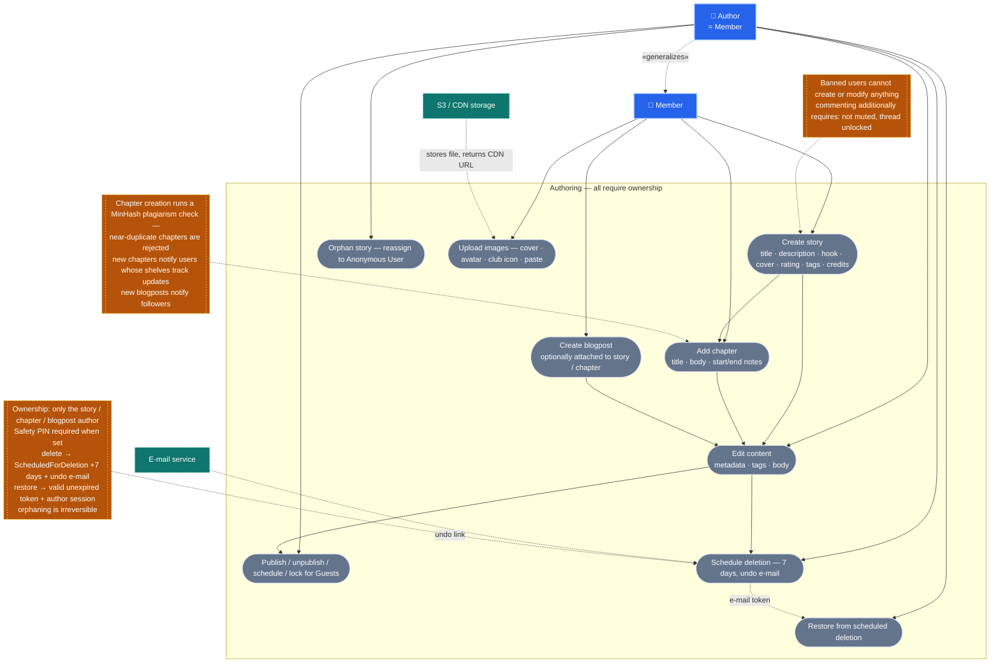
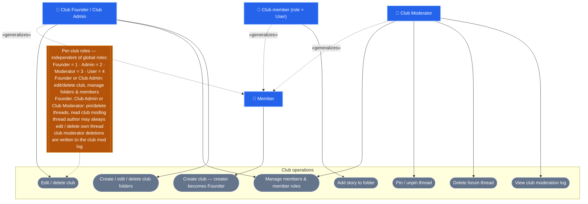
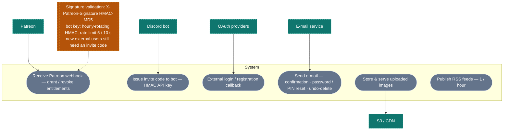

# Ogma3 (Genfic) — UML Use Case Diagram

> Source of the survey behind this document: `.reports/usecase-survey-razor-pages.md`,
> `.reports/usecase-survey-api-endpoints.md`, `.reports/usecase-survey-roles-domain.md`.

## Legend

| Shape | Meaning |
|---|---|
| Rectangle `[…]` | Actor (human role or external system) |
| Oval `([…])` | Use case |
| Dashed box with yellow fill | Condition / note |
| Dotted arrow labelled «generalizes» | Actor generalization (specialization inherits all capabilities) |
| `···»include»···` | Base use case always performs the included one |
| `···»extend»···` | Optional/conditional extension |
| Dashed arrow to note | Preconditions of the attached use case |
| Colour palette | Chosen so label text keeps ≥ 4.4:1 contrast in both light and dark previews (and stays legible even in renderers that ignore per-class text colours) |

---

## 1. Overview — the whole system

```mermaid
flowchart TB
	classDef actor fill:#2563eb,stroke:#bfdbfe,stroke-width:2px,color:#ffffff
	classDef ext fill:#0f766e,stroke:#99f6e4,stroke-dasharray:4 3,color:#ffffff
	classDef uc fill:#64748b,stroke:#e2e8f0,color:#ffffff
	classDef note fill:#b45309,stroke:#fcd34d,stroke-dasharray:3 3,color:#ffffff

	%% ---------- Actors ----------
	guest["👤 Guest<br/>anonymous visitor"]:::actor
	member["👤 Member<br/>registered & confirmed user"]:::actor
	clubstaff["👤 Club staff<br/>per-club role"]:::actor
	moderator["👤 Moderator<br/>global role"]:::actor
	helper["👤 Helper<br/>global staff role"]:::actor
	admin["👤 Admin<br/>global role"]:::actor

	patreon["Patreon"]:::ext
	oauth["OAuth providers<br/>Google · Discord · Tumblr · Patreon"]:::ext
	discordbot["Discord bot"]:::ext
	mail["E-mail service"]:::ext
	cdn["S3 / CDN storage"]:::ext

	member -.->|"«generalizes»"| guest
	clubstaff -.->|"«generalizes»"| member
	moderator -.->|"«generalizes»"| member
	helper -.->|"«generalizes»"| member
	admin -.->|"«generalizes»"| moderator

	%% ---------- System boundary ----------
	subgraph SYS["System — Genfic (Ogma3)"]
	direction TB

		subgraph AUTH["Authentication & account"]
			direction TB
			uc_register(["Create account"]):::uc
			uc_login(["Log in"]):::uc
			uc_passkey(["Sign in with passkey"]):::uc
			uc_logout(["Log out"]):::uc
			uc_account(["Manage account & security<br/>profile · password · 2FA · passkeys · Safety PIN"]):::uc
			uc_privacy(["Manage privacy data<br/>blacklists · blocked users · personal data"]):::uc
			uc_invites(["Issue own invite codes"]):::uc
		end

		subgraph DISC["Discovery & reading"]
			direction TB
			uc_home(["View home page"]):::uc
			uc_search(["Search & browse content<br/>stories · blogposts · tags · clubs"]):::uc
			uc_read(["Read story & chapters"]):::uc
			uc_blog(["Read blogposts & news"]):::uc
			uc_clubview(["Browse clubs, forums & folders"]):::uc
			uc_profile(["View profiles, shelves & libraries"]):::uc
			uc_comments_read(["Read comments & revisions"]):::uc
			uc_rss(["Consume RSS feeds"]):::uc
			uc_static(["View FAQ · docs · staff page"]):::uc
		end

		subgraph CREATE["Authoring"]
			direction TB
			uc_story(["Publish story"]):::uc
			uc_chapter(["Publish chapter"]):::uc
			uc_post(["Publish blogpost"]):::uc
			uc_lifecycle(["Edit · schedule · lock · delete · restore own content"]):::uc
			uc_upload(["Upload images"]):::uc
		end

		subgraph SOCIAL["Social & engagement"]
			direction TB
			uc_comment(["Comment on content"]):::uc
			uc_comment_own(["Edit / delete own comment"]):::uc
			uc_vote(["Vote on stories"]):::uc
			uc_social(["Follow / block users"]):::uc
			uc_shelves(["Manage shelves & shelve stories"]):::uc
			uc_progress(["Track read chapters"]):::uc
			uc_subscribe(["Subscribe to threads & receive notifications"]):::uc
			uc_report(["Report content"]):::uc
			uc_join(["Join / leave clubs"]):::uc
		end

		subgraph CLUBS["Club operations (per-club roles)"]
			direction TB
			uc_create_club(["Create club"]):::uc
			uc_manage_club(["Edit / delete club · manage members"]):::uc
			uc_threads(["Create forum thread · pin / delete threads"]):::uc
			uc_folders(["Manage club folders & add stories"]):::uc
		end

		subgraph STAFF["Moderation & administration"]
			direction TB
			uc_reports(["Review reports"]):::uc
			uc_infractions(["Issue / lift infractions<br/>note · warning · mute · ban"]):::uc
			uc_block(["Content-block / unblock content"]):::uc
			uc_lockthread(["Lock / unlock comment threads"]):::uc
			uc_modinvite(["Moderate invite codes"]):::uc
			uc_news(["Publish site news"]):::uc
			uc_modlog(["View moderator logs & dashboard"]):::uc
			uc_useradmin(["Manage users & roles · impersonate"]):::uc
			uc_catalogs(["Manage catalogs<br/>tags · namespaces · ratings · quotes · FAQs"]):::uc
			uc_sitecontent(["Manage documents · global announcements"]):::uc
			uc_operate(["Operate platform<br/>settings · scripts · e-mail · cache · telemetry"]):::uc
		end
	end

	%% ---------- Guest edges ----------
	guest --> uc_home
	guest --> uc_search
	guest --> uc_read
	guest --> uc_blog
	guest --> uc_clubview
	guest --> uc_profile
	guest --> uc_comments_read
	guest --> uc_rss
	guest --> uc_static
	guest --> uc_register
	guest --> uc_login
	guest --> uc_passkey

	%% ---------- Member edges ----------
	member --> uc_logout
	member --> uc_account
	member --> uc_privacy
	member --> uc_invites
	member --> uc_story
	member --> uc_chapter
	member --> uc_post
	member --> uc_lifecycle
	member --> uc_upload
	member --> uc_comment
	member --> uc_comment_own
	member --> uc_vote
	member --> uc_social
	member --> uc_shelves
	member --> uc_progress
	member --> uc_subscribe
	member --> uc_report
	member --> uc_join
	member --> uc_create_club
	member --> uc_threads

	%% ---------- Club staff ----------
	clubstaff --> uc_manage_club
	clubstaff --> uc_folders
	clubstaff --> uc_threads

	%% ---------- Global staff ----------
	moderator --> uc_reports
	moderator --> uc_infractions
	moderator --> uc_block
	moderator --> uc_lockthread
	moderator --> uc_modinvite
	moderator --> uc_news
	helper --> uc_modlog
	admin --> uc_useradmin
	admin --> uc_catalogs
	admin --> uc_sitecontent
	admin --> uc_operate

	%% ---------- External ----------
	oauth -.->|"«extend» log in"| uc_login
	patreon -.->|"webhook syncs entitlements"| uc_account
	discordbot -.->|"issues invite codes"| uc_register
	mail -.->|"confirmation · reset · undo-delete tokens"| uc_register
	mail -.->|"undo-delete e-mails"| uc_lifecycle
	cdn -.->|"stores uploads"| uc_upload

	%% ---------- Key conditions ----------
	n_reg[["Invite code required<br/>Turnstile + proof-of-work + speed-trap + honeypot<br/>non-disposable e-mail · accept ToS & Privacy<br/>rate limit 5 / 2 h · e-mail confirmation before 1st log-in"]]:::note
	n_read[["Visible content only: published, not content-blocked<br/>rating not blacklisted by default<br/>locked stories hidden from Guests<br/>own drafts visible to author · blocked content to staff"]]:::note
	n_ban[["Any action requires: account not banned<br/>active mute blocks commenting"]]:::note
	n_own[["Ownership required: only the author / owner<br/>Safety PIN checked on deletions<br/>deletion scheduled 7 days with undo e-mail"]]:::note
	n_club[["Club role required<br/>Founder = 1 · Admin = 2 · Moderator = 3 · User = 4<br/>folder access level gates who may add stories"]]:::note
	n_mod[["Global roles: Admin ⊇ Moderator<br/>staff = Admin | Moderator | Helper<br/>every staff action is written to the mod log"]]:::note

	n_reg -.-> uc_register
	n_read -.-> uc_read
	n_own -.-> uc_lifecycle
	n_ban -.-> uc_comment
	n_club -.-> uc_folders
	n_mod -.-> uc_reports
```

---

## 2. Authentication & account

```mermaid
flowchart TB
	classDef actor fill:#2563eb,stroke:#bfdbfe,stroke-width:2px,color:#ffffff
	classDef uc fill:#64748b,stroke:#e2e8f0,color:#ffffff
	classDef note fill:#b45309,stroke:#fcd34d,stroke-dasharray:3 3,color:#ffffff
	classDef ext fill:#0f766e,stroke:#99f6e4,stroke-dasharray:4 3,color:#ffffff

	guest["👤 Guest"]:::actor
	member["👤 Member"]:::actor
	oauth["OAuth providers<br/>Google · Discord · Tumblr · Patreon"]:::ext
	mail["E-mail service"]:::ext

	member -.->|"«generalizes»"| guest

	subgraph AUTH["Authentication & account"]
	direction TB
		uc_reg(["Create account"]):::uc
		uc_redeem(["Redeem invite code"]):::uc
		uc_confirm(["Confirm e-mail address"]):::uc
		uc_login(["Log in with password"]):::uc
		uc_2fa(["Enter 2FA code"]):::uc
		uc_recovery(["Use 2FA recovery code"]):::uc
		uc_ext(["Log in with external provider"]):::uc
		uc_passkey(["Sign in with passkey"]):::uc
		uc_forgot(["Reset password"]):::uc
		uc_logout(["Log out"]):::uc

		uc_profile(["Edit profile<br/>avatar · title · bio · links · timezone"]):::uc
		uc_security(["Change / set password · link external logins"]):::uc
		uc_2famgmt(["Enable / reset 2FA · generate recovery codes"]):::uc
		uc_passkeys(["Register / list / delete passkeys"]):::uc
		uc_pin(["Set / change Safety PIN"]):::uc
		uc_pinreset(["Reset Safety PIN via e-mail"]):::uc
		uc_blacklists(["Manage content blacklists & blocked users"]):::uc
		uc_mail["Manage e-mail address"]:::uc
		uc_pdata(["View / download / delete personal data"]):::uc
		uc_subs(["View Patreon subscription & entitlements"]):::uc
		uc_myinfractions(["View own infractions"]):::uc
		uc_myinvites(["View & issue own invite codes"]):::uc
	end

	guest --> uc_reg
	guest --> uc_login
	guest --> uc_ext
	guest --> uc_passkey
	guest --> uc_forgot

	uc_reg -.->|"«include»"| uc_redeem
	uc_reg -.->|"«include» — mandatory before 1st log-in"| uc_confirm
	uc_login -.->|"«include» if 2FA enabled"| uc_2fa
	uc_login -.->|"«extend» wrong code"| uc_recovery
	uc_login -.->|"«extend» repeated failures"| uc_lockout["Account locked out"]:::uc
	oauth -.->|"«extend» new user also needs invite code"| uc_ext
	mail -.->|"tokens"| uc_confirm
	mail -.->|"token"| uc_forgot
	mail -.->|"token"| uc_pinreset

	member --> uc_logout
	member --> uc_profile
	member --> uc_security
	member --> uc_2famgmt
	member --> uc_passkeys
	member --> uc_pin
	member --> uc_pinreset
	member --> uc_blacklists
	member --> uc_mail
	member --> uc_pdata
	member --> uc_subs
	member --> uc_myinfractions
	member --> uc_myinvites

	n1[["Invite code: 10–18 chars, single-use, required for local AND external sign-up<br/>Turnstile CAPTCHA + proof-of-work + honeypot + speed-trap ≥ 5 s<br/>non-disposable e-mail · ToS + Privacy accepted<br/>rate limits: register 5 / 2 h · log in 10 / 30 min<br/>e-mail confirmation required before first log-in<br/>animated avatar requires Patreon entitlement"]]:::note
	n2[["Deleting content requires the Safety PIN when one is set<br/>Banned users may only visit /Ban and /logout"]]:::note

	n1 -.-> uc_reg
	n2 -.-> uc_pin
```

---

## 3. Discovery & reading (mostly anonymous)

```mermaid
flowchart TB
	classDef actor fill:#2563eb,stroke:#bfdbfe,stroke-width:2px,color:#ffffff
	classDef uc fill:#64748b,stroke:#e2e8f0,color:#ffffff
	classDef note fill:#b45309,stroke:#fcd34d,stroke-dasharray:3 3,color:#ffffff

	guest["👤 Guest / Member"]:::actor

	subgraph DISC["Discovery & reading"]
	direction TB
		uc_home(["View home — recent / top / updated stories"]):::uc
		uc_stories(["Search stories<br/>title: author: rating: status: +tag -tag in:starred in:shelves in:started"]):::uc
		uc_story(["View story page"]):::uc
		uc_chapter(["Read chapter — prev / next"]):::uc
		uc_chsearch(["Search & browse blogposts<br/>tags · title: · author:"]):::uc
		uc_blog(["Read blogpost"]):::uc
		uc_news(["Read site news"]):::uc
		uc_clubs(["Browse / search / sort clubs"]):::uc
		uc_club(["View club · members · forums · modlog"]):::uc
		uc_thread(["Read forum thread"]):::uc
		uc_folder(["View club folder contents"]):::uc
		uc_tag(["View tag & search tags"]):::uc
		uc_profile(["View profile · stories · blogs · follows · library"]):::uc
		uc_shelf(["View shelf"]):::uc
		uc_comments(["Read comments · locate · view revisions"]):::uc
		uc_rss(["RSS: stories · blogposts · story chapters"]):::uc
		uc_info(["FAQ · versioned docs · staff list · Markdown cheatsheet"]):::uc
	end

	guest --> uc_home
	guest --> uc_stories
	guest --> uc_story
	guest --> uc_chapter
	guest --> uc_chsearch
	guest --> uc_blog
	guest --> uc_news
	guest --> uc_clubs
	guest --> uc_club
	guest --> uc_thread
	guest --> uc_folder
	guest --> uc_tag
	guest --> uc_profile
	guest --> uc_shelf
	guest --> uc_comments
	guest --> uc_rss
	guest --> uc_info

	uc_story --> uc_chapter
	uc_club --> uc_thread
	uc_club --> uc_folder

	n1[["Visibility: published · not content-blocked · not locked for Guests<br/>Mature / Adult ratings are blacklisted by default —<br/>Guests never see them; Members see them unless they blacklisted the rating<br/>logged-in users also never see content by blocked users"]]:::note
	n2[["Private shelves: owner only<br/>Private / draft content: author only — drafts visible to author everywhere<br/>locked story chapters: Guests get a 'log in to read' page"]]:::note
	n3[["RSS is rate-limited to 1 request / hour<br/>authors and staff always see their own hidden content"]]:::note

	n1 -.-> uc_stories
	n2 -.-> uc_shelf
	n3 -.-> uc_rss
```

---

## 4. Authoring & content lifecycle

---

## 5. Social & engagement

```mermaid
flowchart TB
	classDef actor fill:#2563eb,stroke:#bfdbfe,stroke-width:2px,color:#ffffff
	classDef uc fill:#64748b,stroke:#e2e8f0,color:#ffffff
	classDef note fill:#b45309,stroke:#fcd34d,stroke-dasharray:3 3,color:#ffffff

	member["👤 Member"]:::actor

	subgraph SOCIAL["Social & engagement"]
	direction TB
		uc_comment(["Post comment"]):::uc
		uc_pow(["Solve proof-of-work challenge"]):::uc
		uc_cedit(["Edit / delete own comment"]):::uc
		uc_vote(["Vote / retract vote on story"]):::uc
		uc_follow(["Follow / unfollow user"]):::uc
		uc_block(["Block / unblock user"]):::uc
		uc_shelf(["Create / edit / delete shelf"]):::uc
		uc_shelve(["Add / remove story on own shelf · quick-add"]):::uc
		uc_read(["Mark chapter read / unread"]):::uc
		uc_subs(["Subscribe / unsubscribe to comment thread"]):::uc
		uc_notif(["View · dismiss · clear notifications"]):::uc
		uc_report(["Report content<br/>comment · user · story · chapter · blogpost · club"]):::uc
		uc_join(["Join club / leave club"]):::uc
		uc_thread(["Create club forum thread · edit own thread"]):::uc
	end

	member --> uc_comment
	member --> uc_cedit
	member --> uc_vote
	member --> uc_follow
	member --> uc_block
	member --> uc_shelf
	member --> uc_shelve
	member --> uc_read
	member --> uc_subs
	member --> uc_notif
	member --> uc_report
	member --> uc_join
	member --> uc_thread

	uc_comment -.->|"«include»"| uc_pow
	uc_shelf --> uc_shelve

	n1[["Post comment requires:<br/>valid proof-of-work · thread not locked · caller not muted<br/>profile owner has not blocked caller<br/>rate limit: reports 5 / hour"]]:::note
	n2[["Ownership: edit / delete only own comments · shelves must be owned by caller<br/>private shelves stay owner-only"]]:::note
	n3[["Founder cannot leave their own club<br/>joining is idempotent with club role = User<br/>adding a story to a folder requires a club role<br/>at least as privileged as the folder access level"]]:::note
	n4[["Notifications are system-generated:<br/>watched story updated · thread comment · followed author posted<br/>comment reply · new follower · system message"]]:::note

	n1 -.-> uc_comment
	n2 -.-> uc_cedit
	n3 -.-> uc_join
	n4 -.-> uc_notif
```

---

## 6. Club operations (per-club roles: Founder / Admin / Moderator / User)

---

## 7. Moderation & administration (global roles)

```mermaid
flowchart TB
	classDef actor fill:#2563eb,stroke:#bfdbfe,stroke-width:2px,color:#ffffff
	classDef uc fill:#64748b,stroke:#e2e8f0,color:#ffffff
	classDef note fill:#b45309,stroke:#fcd34d,stroke-dasharray:3 3,color:#ffffff

	member["👤 Member"]:::actor
	moderator["👤 Moderator"]:::actor
	helper["👤 Helper"]:::actor
	admin["👤 Admin"]:::actor

	admin -.->|"«generalizes»"| moderator
	moderator -.->|"«generalizes»"| member
	helper -.->|"«generalizes»"| member

	subgraph STAFF["Moderation & administration"]
	direction TB
		subgraph M["Admin | Moderator"]
			direction TB
			uc_reports(["Review reports<br/>Open → InReview → Resolved | Rejected"]):::uc
			uc_infractions(["Issue / lift infraction<br/>Note · Warning · Mute · Ban"]):::uc
			uc_block(["Content-block / unblock story · chapter · blogpost"]):::uc
			uc_lock(["Lock / unlock comment thread"]):::uc
			uc_invites(["List invite codes · issue no-limit codes"]):::uc
			uc_usersearch(["Search users — fuzzy match"]):::uc
			uc_newsc(["Create site news"]):::uc
			uc_tagsadmin(["Browse all tags"]):::uc
		end
		subgraph S["Staff: Admin | Moderator | Helper"]
			direction TB
			uc_dash(["Admin dashboard"]):::uc
			uc_modlog(["Global moderator log"]):::uc
			uc_stats(["System statistics & resource stream"]):::uc
			uc_jump(["Jump to reported content"]):::uc
			uc_docslist(["Manage documents / FAQ — read"]):::uc
		end
		subgraph A["Admin only"]
			direction TB
			uc_useradmin(["Create user · assign roles · impersonate"]):::uc
			uc_roles(["Manage roles CRUD"]):::uc
			uc_tax(["Manage tags & tag namespaces — CRUD + bulk import"]):::uc
			uc_catalog(["Manage ratings · quotes · FAQs — CRUD"]):::uc
			uc_docs(["Create / edit documents · edit news"]):::uc
			uc_announce(["Broadcast / archive global announcements"]):::uc
			uc_ops(["Site settings · e-mail · scripts · subscription tiers"]):::uc
			uc_cache(["Purge / inspect cache · telemetry"]):::uc
			uc_revoke(["Revoke unused invite codes"]):::uc
		end
	end

	moderator --> uc_reports
	moderator --> uc_infractions
	moderator --> uc_block
	moderator --> uc_lock
	moderator --> uc_invites
	moderator --> uc_usersearch
	moderator --> uc_newsc
	moderator --> uc_tagsadmin
	helper --> uc_dash
	helper --> uc_modlog
	helper --> uc_stats
	helper --> uc_jump
	helper --> uc_docslist
	admin --> uc_useradmin
	admin --> uc_roles
	admin --> uc_tax
	admin --> uc_catalog
	admin --> uc_docs
	admin --> uc_announce
	admin --> uc_ops
	admin --> uc_cache
	admin --> uc_revoke

	n1[["Ban → site-wide block: Redis BanCache + UserBanMiddleware<br/>every request returns 403 / redirects to /Ban until ActiveUntil<br/>Mute → commenting rejected<br/>end date must be in the future · reason required<br/>impersonation is forbidden when the target is an Admin"]]:::note
	n2[["Every staff action is recorded in the moderator log:<br/>infractions · role changes · blocks · thread locks · catalog edits · invite codes"]]:::note
	n3[["Content-block reason ≥ 20 characters;<br/>blocked content stays visible only to its author and staff<br/>report rate limit for members: 5 / hour"]]:::note

	n1 -.-> uc_infractions
	n2 -.-> uc_modlog
	n3 -.-> uc_block
```

---

## 8. External integrations

---

## 9. Actor & condition reference

### 9.1 Actors

| Actor | Definition |
|---|---|
| Guest | Anonymous visitor. Read-only, plus registration/login. |
| Member | Confirmed, non-banned registered user. Everything Guest can do, plus authoring and social features. |
| Club staff | Per-club roles `Founder = 1`, `Admin = 2`, `Moderator = 3`, `User = 4` — a separate permission space from global roles. |
| Helper | Global staff role with read-only staff access (dashboard, mod log, stats). |
| Moderator | Global role: infractions, reports, content blocks, thread locks, invite code moderation. |
| Admin | Global role: everything Moderator can do, plus users/roles, catalogs, site operations. |
| External | Patreon (entitlements), OAuth providers (Google, Discord, Tumblr, Patreon), Discord bot (invite codes), e-mail service, S3/CDN storage. |

Global roles are DB-managed (`OgmaRole`, `IsStaff` flag); policies:
`RequireAdminRole` = Admin · `RequireAdminOrModeratorRole` = Admin | Moderator · `RequireStaffRole` = Admin | Moderator | Helper.
`Reviewer` is a seeded staff role that no policy references, and `Supporter` is a cosmetic patron role — neither grants any use case by itself.

### 9.2 Global preconditions

| Condition | Effect |
|---|---|
| Account banned | `UserBanMiddleware` blocks every request (403 for APIs, redirect `/Ban` for pages). Only `/Ban` and `/logout` are allowed. Bans are timed and auto-lifted. |
| Account muted | Posting comments is rejected (active `Mute` infraction). |
| Content visibility | Only published (`IsVisible`), non-content-blocked content is listed. Authors see their own drafts; staff see blocked content. |
| Content locks | Locked stories/blogposts are hidden from Guests (chapter reading shows a "log in to read" interstitial). |
| Ratings / maturity | No NSFW flag — maturity is expressed via Ratings. `Mature` and `Adult` are `BlacklistedByDefault`, so Guests never see them and Members only after opting in. |
| User blacklists | Ratings, tags and blocked users are filtered out of every listing for the logged-in user. |
| Ownership | Edit / delete / restore of stories, chapters, blogposts, shelves, comments and folders requires being the owner (or sufficient club role). |
| Safety PIN | Deleting own content requires the Safety PIN when the user has set one. |
| Soft delete | Deletion is scheduled for 7 days and an undo e-mail with a restore token is sent. |
| Antiforgery + PoW | Mutating endpoints validate antiforgery tokens; comment creation requires a proof-of-work challenge. |

### 9.3 Rate limits

| Scope | Limit |
|---|---|
| `POST /login` | 10 / 30 min |
| `POST /register` (+ external-login confirmation) | 5 / 2 h |
| `POST /api/reports` | 5 / h |
| `GET /rss/*` | 1 / h |
| `GET /api/quotes/random` | 1 / 5 s |
| `GET /api/pow/issue` | 5 / min |
| `GET /api/generate-invite-code` (bot) | 5 / 10 s |

### 9.4 Key routes per area

| Area | Routes |
|---|---|
| Auth | `/login`, `/register`, `/confirm-email`, `/forgot`, `/reset`, `/reset-pin`, `/2fa`, `/external-login`, `/identity/account/**` |
| Stories | `/stories`, `/stories/create|edit|delete|restore|orphan`, `/story/{id}`, `/story/{id}/add-chapter`, `/chapters/edit|delete|restore` |
| Blog / news | `/blog`, `/blog/create|edit|delete|restore`, `/news` |
| Clubs | `/clubs`, `/clubs/create|edit/{id}`, `/club/{id}/**`, `/club/{clubId}/folders|folder/**`, `/club/thread/{id}/**` |
| Social API | `/api/comments`, `/api/votes`, `/api/users/follow|block`, `/api/shelves`, `/api/ShelfStories`, `/api/subscriptions/thread`, `/api/notifications`, `/api/reports`, `/api/clubjoin`, `/api/folders/AddStory`, `/api/chaptersread` |
| Moderation | `/admin/reports`, `/admin/infractions`, `/admin/contentblock`, `/admin/api/infractions`, `/api/CommentsThread/lock` |
| Admin | `/admin/**`, `/api/tags`, `/api/tagnamespaces`, `/api/ratings`, `/api/quotes`, `/api/faqs`, `/api/roles`, `/admin/api/cache`, `/admin/api/telemetry/*` |
| Feeds / hooks | `/rss/stories`, `/rss/blogposts`, `/rss/story/{id}/chapters`, `/hooks/patreon` |
